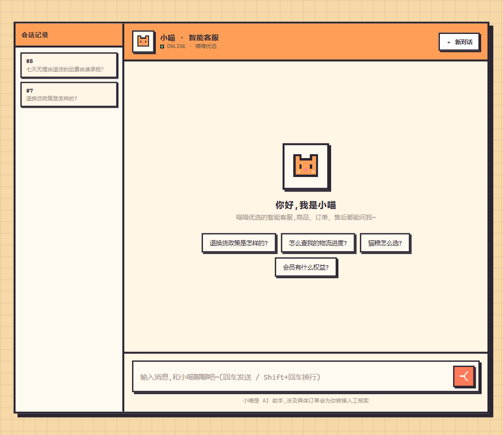

# 售后小灵智能客服

基于 **MewHelp《AI Agent 智能客服实战》课程配套源码**的学习实践项目，使用 FastAPI、LangGraph 和 RAG 构建电商售后客服。本仓库新增了阿里云百炼适配副本及本地部署配置，**不是从零原创整个系统**。

> 验证状态：百炼聊天、嵌入、重排及带引用的知识问答此前在本机实测成功。**2026-10-20 本次 README 复查中，网页和 API 对同一退货运费问题均返回兜底话术、没有引用，回归原因尚未定位；当前不能宣称知识问答稳定可用。**订单物流、完整退款流程、Langfuse 和模型训练尚未完成端到端验收。文中的运行记录不代表全量测试通过。

## 效果展示



页面品牌沿用课程源码的「喵喵优选 / 小喵」，仓库项目名为「售后小灵智能客服」。截图来自本地实际运行页面，不是设计稿。

此前验证成功的问题：**七天无理由退货的运费由谁承担？**

实际回答要点：无理由退货的退回运费由买家承担；因商品质量问题、发错货、少发漏发导致的退换货，运费由平台承担。响应包含知识库引用及完成事件。

## 能力与技术栈

- **对话编排**：FastAPI + LangGraph / LangChain，包含意图分流、多轮上下文、工具调用和退款子流程。
- **知识检索**：MySQL 存知识块，Milvus 提供向量与 BM25 召回，随后重排，回答携带引用。
- **业务工具**：内置订单、FAQ、退款等工具，以及物流 / 售后两台 MCP Server。
- **扩展章节**：Langfuse 观测、数据飞轮、主题分类器训练与 ONNX 推理；本次部署未验收这些扩展。

### 本仓库的适配内容

| 文件 | 作用 |
| --- | --- |
| `deployment-local/bailian/run.py` | 百炼专用启动入口；运行时加载适配副本，不覆盖原应用文件 |
| `deployment-local/bailian/rerank.py` | 适配百炼原生重排请求及 `output.results` 响应 |
| `deployment-local/bailian/embeddings.py` | 嵌入按每批最多 10 条拆分请求 |
| `deployment-local/docker-compose.local.yml` | MySQL 映射至本机 `127.0.0.1:3307`，避开已有 3306 |

## 本地运行：百炼适配版

以下步骤在**仓库根目录**执行。需要 uv、Docker 和 Git；无需手动创建虚拟环境。主链路建议至少准备 8 GB 内存和充足磁盘，实际占用以机器和容器状态为准。

### 1. 获取源码并安装依赖

```bash
git clone https://github.com/27adadadad/shouhou-xiaoling-zhineng-kefu.git
cd shouhou-xiaoling-zhineng-kefu
uv sync
```

### 2. 配置百炼

复制 `.env.example` 为 `.env`（PowerShell 用 `Copy-Item .env.example .env`），编辑以下字段。保留模板中的其他配置。

```dotenv
CHAT_BASE_URL=https://dashscope.aliyuncs.com/compatible-mode/v1
CHAT_MODEL=你的百炼账号已开通的聊天模型ID
CHAT_API_KEY=你的百炼API密钥
EMBED_API_KEY=同一个百炼API密钥
RERANK_API_KEY=同一个百炼API密钥
```

三项密钥字段都需存在，以通过原配置校验。适配入口实际复用 `CHAT_API_KEY`；嵌入固定使用 `text-embedding-v4`（本次实测 1024 维），重排固定使用 `gte-rerank-v2`。

**当前适配入口的重排地址固定为北京地域 DashScope 地址**。其他地域、Coding Plan 专属密钥、模型权限或配额不保证兼容。不要仅凭聊天成功就认定嵌入和重排也可用。

不要提交 `.env`，也不要将真实密钥写进截图、日志或 README。

### 3. 启动基础容器

本次原 MinIO 镜像地址拉取失败，使用 `milvusdb` 命名空间下的同版本镜像，并在本地打兼容标签。此步骤不是声明两个仓库的镜像内容完全相同。

```bash
docker pull milvusdb/minio:RELEASE.2024-05-28T17-19-04Z
docker tag milvusdb/minio:RELEASE.2024-05-28T17-19-04Z minio/minio:RELEASE.2024-05-28T17-19-04Z
docker compose -p mewhelp --project-directory . -f deployment-local/docker-compose.local.yml up -d
docker compose -p mewhelp --project-directory . -f deployment-local/docker-compose.local.yml ps
```

等待 MySQL、etcd、MinIO、Milvus 全部 `healthy`。显式指定 `-p mewhelp` 可避免中文目录导致项目名为空；`--project-directory .` 保证 SQL 挂载路径指向仓库根目录。

首次创建 MySQL 数据卷会自动执行 `sql/` 中的初始化脚本。已有旧卷时应核对表和迁移；不要随意运行 `down -v`，它会删除项目数据库和知识库存储卷。

### 4. 建立知识库

```bash
uv run python deployment-local/bailian/run.py scripts.build_kb
uv run python deployment-local/bailian/run.py scripts.vectorize_kb
```

向量化会调用百炼并消耗对应额度。本次实测 52 个文档块完成向量化，Milvus 中有 52 条记录；后续增补文档后数量可能变化。重新运行建库脚本会检查现有文档块，勿为了重跑直接清库。

### 5. 启动应用与 MCP

打开三个终端，每个终端都进入仓库根目录，分别保持以下进程运行：

```bash
# 终端一：物流 MCP
uv run python mcp_servers/logistics_server.py

# 终端二：售后 MCP
uv run python mcp_servers/aftersales_server.py

# 终端三：百炼适配应用
uv run python deployment-local/bailian/run.py
```

访问 <http://127.0.0.1:8000/>。停止时在各终端按 `Ctrl+C`。日常停容器可使用同一 Compose 命令的 `stop`，不会删除数据卷。

**不要用原版 `make dev` 替代百炼入口**：它不会加载上述适配副本。原版评估脚本也不一定会加载适配；需要适配配置的 Python 模块应通过 `run.py 模块名` 执行。原版 `smoke_rerank.py` 直接请求硅基流动格式，不能作为百炼原生重排的通过依据。

## 验证记录与边界

| 项目 | 本次已观察结果 |
| --- | --- |
| 四个基础容器 | MySQL、etcd、MinIO、Milvus 均 healthy |
| 百炼嵌入 / 重排 | 真实接口均 HTTP 200；嵌入 1024 维，重排返回相关性排序 |
| 知识库 | 52 个文档块已写入 MySQL 并完成 Milvus 向量化 |
| 网页 / 知识问答 | 此前页面 HTTP 200 且问答带引用；本次复查 HTTP 200 但回复兜底、无引用，存在未解决回归 |
| 重排适配离线探针 | 原版无法解析原生响应；副本成功；回滚恢复原版行为 |
| 嵌入分批离线探针 | 21 条输入由原版单批改为 10 + 10 + 1；回滚恢复单批 |
| 未完成验收 | 订单物流、完整退款流程、全量单测、Langfuse、飞轮、分类器训练 |

本地依赖安装和一次成功问答，不能证明所有课程章节都可运行。首次克隆到其他电脑的完整安装流程尚未独立复现；网络、权限、内存和模型权限都可能影响结果。Docker 与 Python 曾在本机出现内存分配失败，遇到此类报错应先检查资源，不要把所有服务强行同时拉起。

## 端口与目录

| 端口 | 服务 |
| --- | --- |
| 8000 | FastAPI 与聊天页面 |
| 8101 / 8102 | 物流 / 售后 MCP |
| 3307 | 本适配版 MySQL 宿主端口，容器内部仍为 3306 |
| 19530 / 9091 | Milvus / 健康检查 |

核心目录：`app/api` 为接口，`app/graph` 为编排，`app/core` 为模型与检索能力，`app/kb` 为知识库处理，`app/tools` 为工具，`mcp_servers` 为独立 MCP 服务，`sql` 为数据库脚本，`scripts` 为评估及离线任务。

## 来源与使用说明

原项目为 **MewHelp《AI Agent 智能客服实战》课程配套源码**，保留了原作者的代码标注。原 README 完整保存在 [课程原版说明](docs/COURSE_README.md)。本仓库的百炼适配、Windows 本地端口避让与运行验证，是在课程源码上的学习实践。

仓库当前未附明确的上游开源许可证。**公开可见不等于获得任意复制、再分发或商用授权**；使用和传播前应核实课程及原作者的授权条件。本仓库不额外授予上游代码的使用权。
